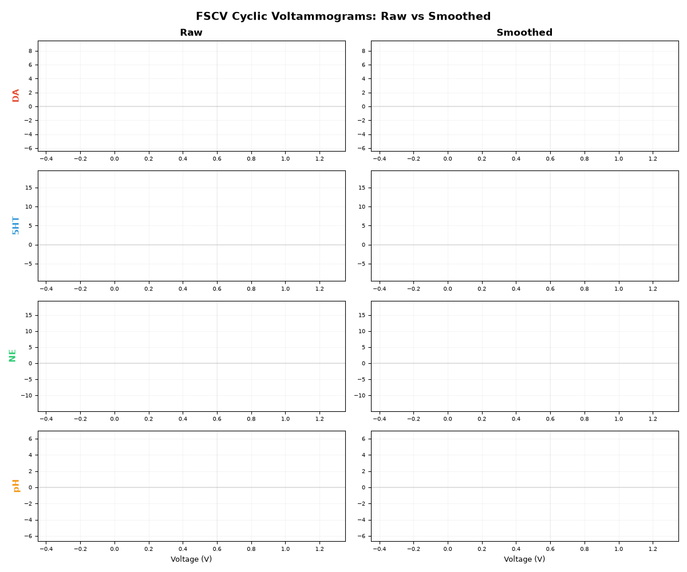
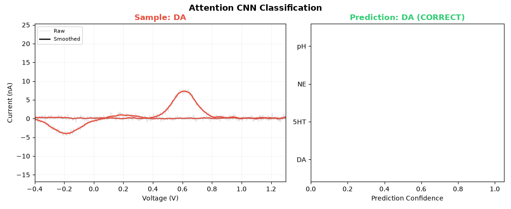
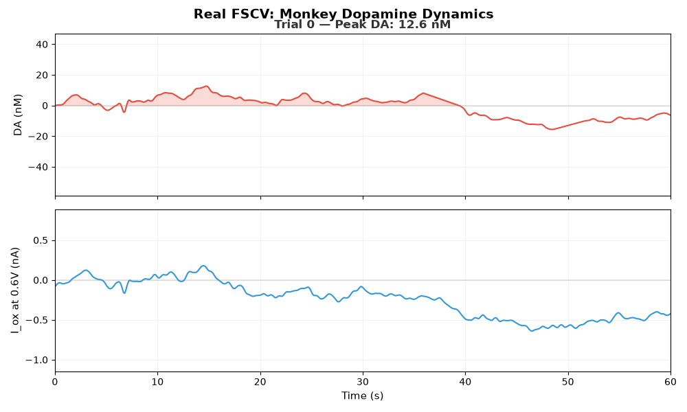

# FSCV Neurotransmitter Classification

Deep learning and ML pipeline for classifying neurotransmitters from Fast-Scan Cyclic Voltammetry data, validated on real primate recordings.

## Demos

<p align="center">
  
</p>
<p align="center"><em>Voltage sweep traces for DA, 5-HT, NE, and pH — each analyte produces a distinct CV shape</em></p>

<p align="center">
  
</p>
<p align="center"><em>Attention 1D-CNN classifying voltammograms with prediction confidence</em></p>

<p align="center">
  
</p>
<p align="center"><em>Real FSCV data from awake monkey — dopamine release events detected from oxidation current</em></p>

## Background

FSCV applies a rapid triangular voltage sweep (-0.4V to +1.3V at 400 V/s) to a carbon fiber microelectrode. Neurotransmitters oxidize and reduce at characteristic potentials, producing unique cyclic voltammograms (CVs). DA and NE have nearly identical oxidation potentials (~0.6V), which makes separating them electrochemically difficult. This project explores how well ML models can learn to make that distinction from CV shape alone.

## Results

### Synthetic data — 4-class classification

8,000 synthetic CVs (2,000/class: DA, 5-HT, NE, pH), 50–2500 nM, 10 electrode variations.

| Model | Type | Accuracy | F1 |
|-------|------|----------|-----|
| Attention 1D-CNN | DL | **98.6%** | **0.986** |
| Bidirectional GRU | DL | 98.2% | 0.982 |
| SVM+PCA (raw CV) | ML | 98.1% | 0.981 |
| 1D-CNN | DL | 98.0% | 0.980 |
| RF (raw CV) | ML | 97.5% | 0.975 |
| SVM+PCA (features) | ML | 96.8% | 0.968 |
| RF (features) | ML | 96.6% | 0.965 |
| GRU | DL | 94.4% | 0.942 |
| LSTM | DL | 94.1% | 0.939 |

DA vs NE is the hardest pair (1.3% DA misclassified as NE), consistent with their overlapping electrochemistry. Low concentrations (<500 nM) drop to 92.9% accuracy vs 100% above 1500 nM. The ox/red peak ratio is the strongest discriminating feature. CNNs beat RNNs here because CV shape is spatial, not sequential — the bidirectional GRU is the exception, since it reads the sweep in both directions.

### Real data — monkey FSCV dopamine

1,411 trials from awake macaque (Zenodo 14825992), 60s each at 10 Hz. PCA-extracted DA, pH, movement, and oxidation current at 0.6V.

**DA release detection (binary):**

| Model | Accuracy | F1 |
|-------|----------|-----|
| Random Forest | 80.9% | 0.761 |
| SVM (RBF) | 80.9% | 0.752 |

**DA concentration regression (from iox only):**

| Model | R² | RMSE |
|-------|-----|------|
| RF Regressor | 0.654 | 5.10 nM |
| 1D-CNN | 0.653 | 5.10 nM |

These models use only the oxidation current at 0.6V — a single channel, not full voltammograms. With complete CV data (as from glassy carbon microelectrodes), accuracy would improve substantially.

## Pipeline

```
generate_synthetic_data.py   →  8000 synthetic CVs across 4 analyte classes
preprocessing.py             →  smoothing, z-score normalization, split
feature_extraction.py        →  14 electrochemical features (peaks, widths, charges)
baseline_models.py           →  RF and SVM+PCA baselines
cnn_model.py                 →  1D-CNN + Attention 1D-CNN with voltage-region maps
lstm_model.py                →  LSTM, GRU, Bidirectional GRU
final_comparison.py          →  cross-model comparison, per-concentration analysis
real_data_analysis.py        →  real monkey FSCV: detection + regression
generate_gifs.py             →  animated visualizations
```

## Models

| Model | Input | Params | Notes |
|-------|-------|--------|-------|
| Random Forest | 14 features | — | Peaks, charges, ratios |
| SVM + PCA | Raw CV (1000 pts) | — | RBF kernel, 50 PCs |
| 1D-CNN | Raw CV (1000 pts) | 279K | 4 conv blocks + global pool |
| Attention 1D-CNN | Raw CV (1000 pts) | 98K | Learned voltage-region weighting |
| LSTM | 200 × 2 (current + voltage) | 208K | 2-layer, last hidden state |
| GRU | 200 × 2 | 158K | 2-layer gated recurrent |
| Bidirectional GRU | 200 × 2 | 415K | Forward + reverse sweep |
| 1D-CNN Regressor | 30-pt iox window | ~5K | DA concentration from oxidation current |

## Data

- **Synthetic**: Generated from published electrochemical parameters — Gaussian peaks at known oxidation/reduction potentials with electrode-to-electrode variation and noise
- **Real (monkey)**: [Zenodo 14825992](https://zenodo.org/records/14825992) — 1,411 trials, PCA-extracted signals at 10 Hz (CC BY 4.0)
- **Characterization**: Mayo Clinic flow cell recordings (Asp et al., FSCVIntegralMethods) — DA, NE, DOPAC, Guanine

## Project structure

```
fscv_classification/
├── check_environment.py
├── generate_synthetic_data.py
├── preprocessing.py
├── feature_extraction.py
├── baseline_models.py
├── cnn_model.py
├── lstm_model.py
├── final_comparison.py
├── real_data_analysis.py
├── generate_gifs.py
├── figures/                      # static plots (13 PNGs)
├── gifs/                         # animated visualizations
├── data/                         # synthetic data (gitignored)
├── real_data/                    # real recordings (gitignored)
└── results/                      # model weights + metrics (gitignored)
```

## Context

Built as part of ongoing work in the Neural Electrode Interface Technologies Lab (Dr. Castagnola, Louisiana Tech), where glassy carbon microelectrodes enable simultaneous electrophysiology and electrochemistry. The lab's electrodes can record both neural spikes and neurotransmitter release — but FSCV voltage sweeps create artifacts that mask spike waveforms. ML-based classification and artifact removal are natural next steps.

## References

- Castagnola et al., "Glassy Carbon Microelectrode Arrays Enable Voltage-Peak Separated Simultaneous Detection of Dopamine and Serotonin"
- Twomey et al., "Deep Learning Architectures for FSCV, a Comparison", arXiv:2212.01960
- Zenodo 14825992: Monkey FSCV dopamine data (CC BY 4.0)
- Asp et al., FSCVIntegralMethods — Mayo Clinic characterization data
